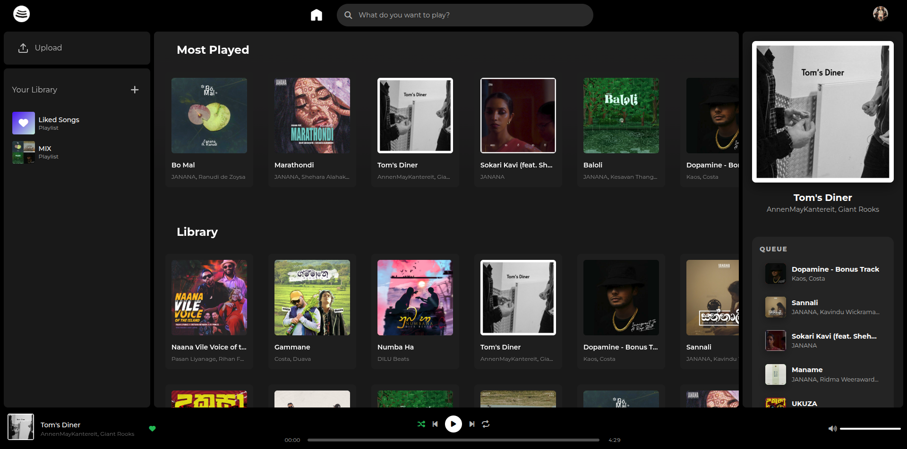
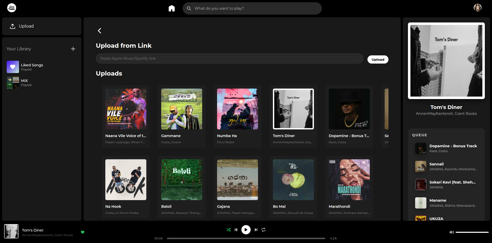
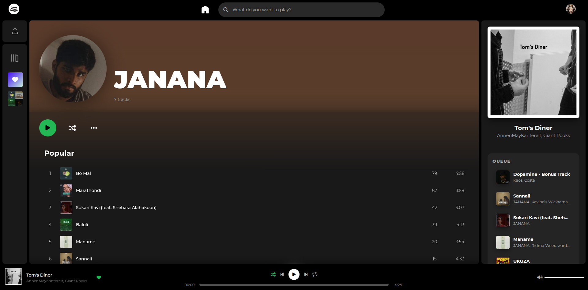
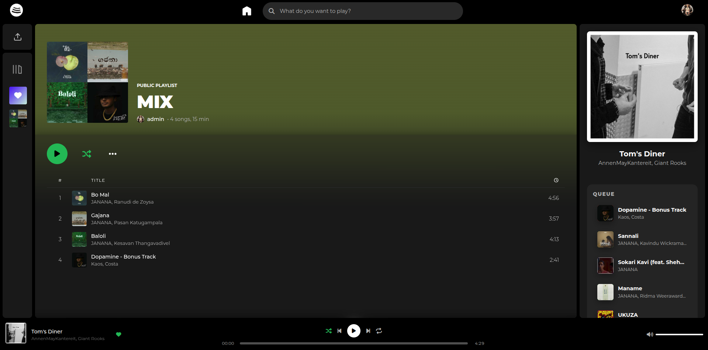

# Openfy

A self-hosted music streaming platform.

## Prerequisites

- For bare-metal install: current Ubuntu/Debian, Python 3.11+, `ffmpeg`, systemd
- For Docker install: Docker and Docker Compose
- For manual setup: Python 3.11+

## Quick Start (bare-metal Linux, no Docker)

Download the `openfy-vVERSION-linux-amd64.tar.gz` (x86-64) or
`openfy-vVERSION-linux-arm64.tar.gz` (ARM64) archive from the
[Releases page](https://github.com/NethminaYasas/Openfy/releases),
plus `SHA256SUMS`, then:

```bash
sha256sum -c --ignore-missing SHA256SUMS   # every downloaded file must report OK
tar -xzf openfy-vVERSION-linux-amd64.tar.gz
cd openfy-vVERSION-linux-amd64
sudo ./install.sh
```

Then generate an admin credential, save it to the config, and restart:

```bash
sudo /opt/openfy/venv/bin/python /opt/openfy/generate_hash.py
sudoedit /etc/openfy/openfy.env   # set OPENFY_ADMIN_HASH to the value above
sudo systemctl restart openfy
```

Visit http://localhost:8000 (or `http://<server-ip>:8000`).

Full guide — configuration, systemd service commands, upgrades via
`update.sh`, safe uninstall, data locations, backups, troubleshooting:
[`docs/LINUX_INSTALL.md`](docs/LINUX_INSTALL.md).

## Installation

### Option A — Bare-metal Linux without Docker (recommended)

Same as Quick Start above. No Docker, no Node.js. App lives in
`/opt/openfy`, config in `/etc/openfy/openfy.env`, data in
`/var/lib/openfy/` (database, music, downloads, artwork) — config and data
survive updates, reinstalls, and normal uninstalls.

### Option B — Docker, published image

No build needed. Pin a released version (see the
[Releases page](https://github.com/NethminaYasas/Openfy/releases)):

```bash
cp .env.example .env   # fill in your values
OPENFY_VERSION=1.4.2 docker compose -f docker-compose.prod.yml up -d
```

Images: `ghcr.io/nethminayasas/openfy:1.4.2` (also `:1.4`, `:1`, `:latest`).
Prefer an explicit version in production; `latest` moves on every stable
release and prereleases (e.g. `1.5.0-rc.1`) never touch the stable aliases.
Multi-arch: `linux/amd64` and `linux/arm64`.

### Option C — Docker from source (development)

```bash
cp .env.example .env   # fill in your values
docker compose up --build -d
```
### Configuration and admin credentials

Copy `.env.example` to `.env` and fill in your values before starting.

```bash
python scripts/generate_hash.py   # paste the of1_... value as OPENFY_ADMIN_HASH
```

Bare-metal installs keep their config at `/etc/openfy/openfy.env` and data
at `/var/lib/openfy/` (database, music, downloads, artwork) — both survive
updates, reinstalls, and normal uninstalls.

### Upgrading

- Docker (prod): set `OPENFY_VERSION` to the new release and
  `docker compose -f docker-compose.prod.yml up -d`.
- Bare-metal: `sudo /opt/openfy/update.sh --latest` (verifies checksums,
  backs up config + database, rolls back on failure).

## Manual Setup

```bash
git clone https://github.com/NethminaYasas/Openfy.git
cd Openfy
cp .env.example .env   # fill in your values (also used by manual setup)
cd server
pip install -r requirements.txt
uvicorn app.main:app --reload
```

## Features

- **Web-based music player** - Stream your music library from any browser
- **Desktop & Mobile UI** - Dedicated mobile frontend served automatically for mobile devices
- **Upload music** - Upload local audio files (mp3, flac, wav, m4a, ogg, opus)
- **Spotify/Apple Music downloads** - Download tracks from streaming services via SpotiFLAC
- **Spotify playlist import** - Import entire Spotify playlists and albums with automatic deduplication
- **Multi-user support** - Each user gets their own library, playlists, and queue
- **Liked Songs** - Universal "Liked Songs" playlist per user
- **Playlist management** - Create, rename, reorder, pin, and share public playlists
- **Follow playlists, albums & artists** - Follow other users' public playlists plus albums and artists
- **Album management** - Auto-organized album views with artwork extraction
- **Artist pages** - Dedicated artist pages with all tracks and albums
- **Search** - Search by track title, artist name, or album title
- **Spotify search** - Search Spotify directly from the UI
- **Queue system** - Persistent per-user queue with drag-and-drop reorder, shuffle, and repeat
- **Player state persistence** - Shuffle and repeat settings, queue, last track, and library state saved per user (volume is local-only)
- **User avatars** - Upload profile pictures
- **Audio streaming** - HTTP range-request support for seeking and partial content
- **Admin dashboard** - User management, track management, system settings, and server stats
- **Rate limiting** - Auth endpoints protected against brute force (10 signups / 15 signins per 5 min per IP)
- **Stream tokens** - Time-limited tokens (120s TTL) for secure audio streaming
- **Docker deployment** - Containerized setup with automatic database initialization and healthcheck
- **SpotiFLAC auto-update** - Docker build automatically installs latest SpotiFLAC from upstream

## Screenshots

### Home Page


### Upload Page


### Artist Page


### Playlist Page


> All screenshots live in the `docs/screenshots/` directory.

## Configuration

Copy `.env.example` to `.env` and fill in your values before starting.

Available environment variables (all prefixed with `OPENFY_`, except `SPOTIFLAC_PIN_VERSION` which is a build-time-only variable read by `scripts/check_spotiflac_update.sh`):

| Variable | Default | Description |
|----------|---------|-------------|
| `OPENFY_ENV` | `dev` | Environment mode |
| `OPENFY_DATABASE_URL` | `sqlite:///./data/openfy.db` | Database connection string |
| `OPENFY_DATA_DIR` | `./data` | Data directory path |
| `OPENFY_MUSIC_DIR` | `./data/music` | Music library path |
| `OPENFY_DOWNLOADS_DIR` | `./data/downloads` | Downloads directory |
| `OPENFY_ARTWORK_DIR` | `./data/artwork` | Album art cache directory |
| `OPENFY_ALLOWED_ORIGINS` | `http://localhost` | CORS allowed origins (docker-compose overrides to `http://localhost:8000,http://127.0.0.1:8000`) |
| `OPENFY_ADMIN_USERNAME` | `` | Admin username (auto-created on startup) |
| `OPENFY_ADMIN_HASH` | `` | Random admin credential (`of1_...`, 64 chars) from `scripts/generate_hash.py` |
| `OPENFY_MAX_UPLOAD_SIZE_MB` | `200` | Maximum upload file size in MB |
| `SPOTIFLAC_PIN_VERSION` | `` | Pin SpotiFLAC to a specific version (e.g. `0.7.0`). Leave empty for latest. No `OPENFY_` prefix. |

## Generating an Admin Hash

```bash
python scripts/generate_hash.py
```

Copy the output into your `.env` as `OPENFY_ADMIN_HASH`, then restart the server.
Use this credential in the Auth Hash sign-in field and keep it secret. The generator
uses cryptographically secure randomness and does not accept a password.

### Rotating existing administrator credentials

Password-derived administrator hashes are no longer accepted, including credentials
still stored in the database. Generate a fresh credential with the command above,
replace `OPENFY_ADMIN_HASH`, and restart with the same `OPENFY_ADMIN_USERNAME`.
Startup rotates the existing account's credential and its ownership references in
one transaction, preserving its library and playlists. Sign in again with the new
credential; the old credential no longer works. Repeat for each existing administrator.

The `scripts/` directory contains developer/admin utilities.

## Architecture

- **Frontend**: Vanilla JS with ES modules in `client/modules/` - no Node.js/npm required
- **Backend**: FastAPI (Python) with SQLAlchemy ORM
- **Database**: SQLite (auto-initialized on first run)
- **Audio streaming**: HTTP range requests with optional time-limited stream tokens
- **SPA routing**: All non-API routes serve `index.html` for client-side routing
- **Mobile**: Separate mobile UI auto-detected via User-Agent
- **Queue Manager**: `client/modules/queue-manager.js` is the single source of truth for the playback queue
- **SpotiFLAC**: Upstream SpotiFLAC package (auto-updated to latest at Docker build time, pinnable via `SPOTIFLAC_PIN_VERSION`) + local Apple Music/Spotify fallback downloader (`server/app/spotiflac_local/`, via YouTube Music)

## Tech Stack

- **Frontend**: HTML5, CSS3, Vanilla JavaScript (ES Modules)
- **Backend**: FastAPI (Python 3.11+; Docker ships 3.11-slim, CI tests 3.12)
- **Database**: SQLite via SQLAlchemy
- **Auth**: X-Auth-Hash header (token-based, no Bearer/JWT)
- **Containerization**: Docker with healthcheck and auto-restart

## License

GNU General Public License v3.0
